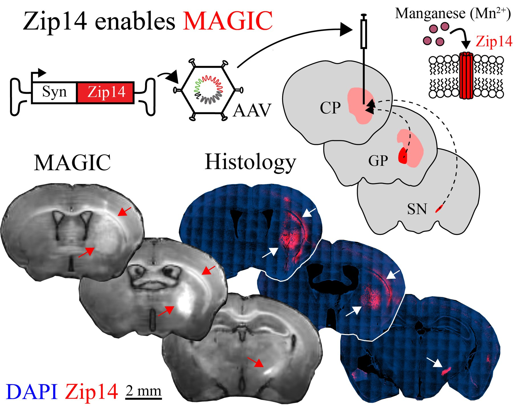
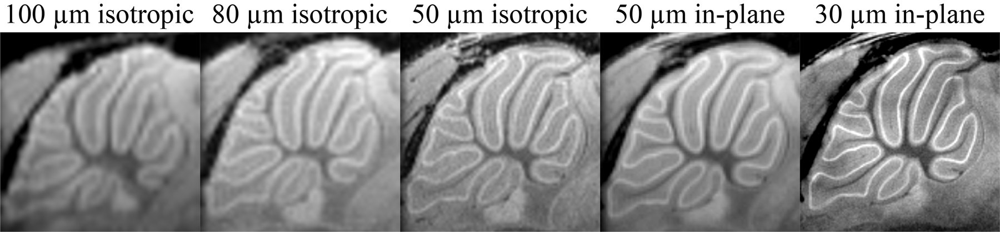
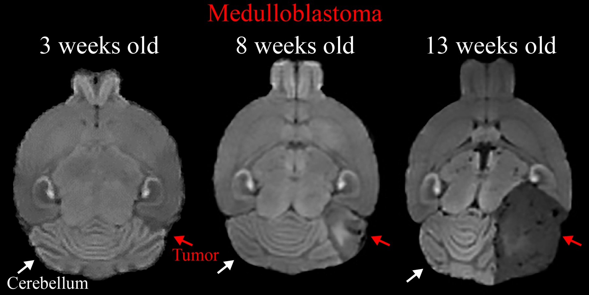
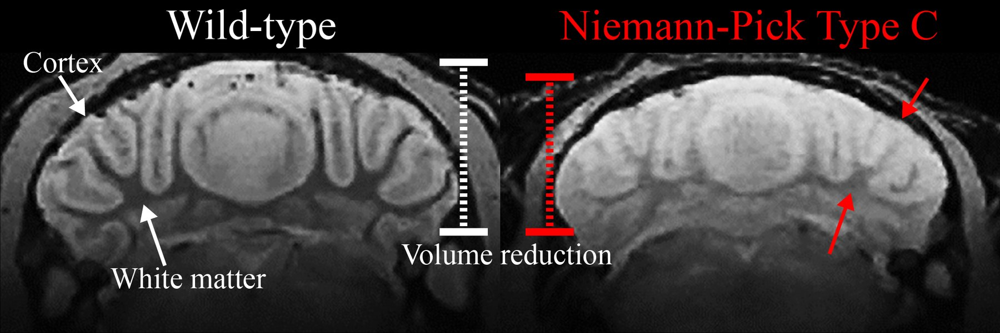

My research program is focused on developing imaging tools to report biological function in living subjects.

<figure class="fig-right fig-magic"></figure>
<h2>MRI-visible expression reporters for translational molecular imaging</h2>

We are at the threshold of detecting gene expression, cell function, and disease state in living subjects over the whole organism using molecular MRI. I discovered that the manganese (Mn2+) transport protein Zip14 can be applied as a robust MRI-visible gene expression reporter (i.e., GFP for MRI) to enable mesoscale neural tracing in vivo. I call this system Manganese Accumulation for Genetically Inducible Contrast (MAGIC) MRI.<a href="https://doi.org/10.64898/2026.04.30.722028">1</a>,<a href="https://doi.org/10.1002/mrm.29993">2</a>

## Cellular resolution MRI

A frontier for brain MRI is achieving cellular specificity and eventually cellular resolution. Manganese-enhanced MRI (MEMRI) produces layer-specific contrast enabling in vivo visualization of cellular cytoarchitecture, particularly in the cerebellum, as Mn2+ acts like a natural contrast agent that helps water protons relax faster and appear brighter on T1-weighted scans. By performing near single cell (30-50 µm isotropic) resolution imaging in vivo, I discovered that a single cell type was responsible for cerebellar Mn2+ uptake.<a href="https://doi.org/10.1016/j.neuroimage.2023.120198">3</a>

<figure class="fig-strip"></figure>

## High-throughput screening pipelines for mouse models of human neurological disorders

<figure class="fig-right"></figure>

Genetically engineered mouse models of sporadic cancers are critical for studying tumor biology and for preclinical testing of therapeutics, but the inherent heterogeneity of sporadic mouse models of medulloblastoma (MB) makes studies of tumor progression and preclinical drug trials difficult without an in vivo imaging readout. I developed an MRI-based pipeline producing high resolution, quantitative information about tumor progression and response to therapy in MB models.<a href="https://doi.org/10.1002/mrm.27904">4</a>

<figure class="fig-right"></figure>

Niemann-Pick Type C (NPC) is a rare genetic disorder characterized by progressive cell death, particularly in cerebellar Purkinje cells, with no known cure. I presented longitudinal MEMRI data from cohorts of wild-type, heterozygote carrier, and homozygote mutant NPC mice which revealed significant volume reductions and aberrant sub-regional Mn2+ uptake over time and across genotypes.<a href="https://doi.org/10.1016/j.neuroimage.2020.116894">5</a>

